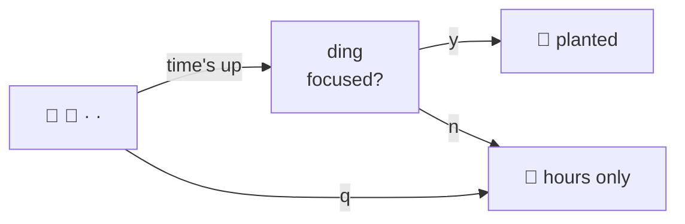

# bonsai 🌱

A focus timer for my Mac's terminal. It dings in my headphones, tracks where my time goes, and grows a garden from the sessions I finish.

I kept missing the alert in other timers. I liked Forest, but it was buggy and on my phone, the thing I'm trying not to pick up. And I wanted to see where my hours actually go.

```
╭──────────────────── bonsai ────────────────────╮
│                                                │
│    work                                        │
│                                                │
│     ▀█ █▀▀   ▀▀█  ▀█                           │
│      █ █▀█ ▀  ▀█   █                           │
│      ▀ ▀▀▀ ▀ ▀▀▀   ▀                           │
│                                                │
│    ━━━━━━━━━━━━━━━━━╸                          │
│    🌱 🌱 · ·                                   │
│                                                │
╰────────────────── q to stop ───────────────────╯
```

## Setup

Needs macOS and [uv](https://docs.astral.sh/uv/). Add to `~/.zshrc`:

```sh
alias bonsai="uv run ~/git/bonsai/bonsai.py"
alias bon=bonsai
```

Check the sound: `bon test-ding`

## A session



```sh
bon start w 30         # work
bon start writing 45   # life tags are typed in full
bon                    # repeat the last one
```

## My week

```
$ bon week
  Day              Work   Life
 ──────────────────────────────
  Mon 2026-11-23    2.5    0.5
  Tue 2026-11-24    2.5    1.0
  Wed 2026-11-25    2.5    0.5
  ...
  Total             7.5    2.0

Work 7.5h / 40h  ████████░░░░░░░░░░░░░░░░░░░░░░░░░░░░░░░░
```

The bar is green, then yellow at 32h and red at 38h.

## My garden

One plant per 30 minutes. Work is always 🌵, and each life tag has its own plant.

```
$ bon garden
Garden  streak 3  ·  best 3  ·  19 plants

  Mon 2026-11-23   🌵 🌵 🌵 🌵 🌵   🍄        3.0
  Tue 2026-11-24   🌵 🌵 🌵 🌵 🌵   🌻 🌻     3.5
  Wed 2026-11-25   🌵 🌵 🌵 🌵 🌵   🍄        3.0

🌵 work  🍄 learning  🌻 writing
```

## Everything else

```sh
bon today                  # today's sessions
bon tag writing 🌻         # pick a life tag's plant
bon log w 30 --at 14:00    # add one I forgot
bon log w --start 9:00 --end 11:30   # or give the times
bon undo                   # delete the last one
bon export                 # CSV of everything
```

Data lives in `~/.bonsai/bonsai.db`. Sound, repeats and volume are at the top of `bonsai.py`.

Tests: `uv run --with pytest --with rich pytest -q`
